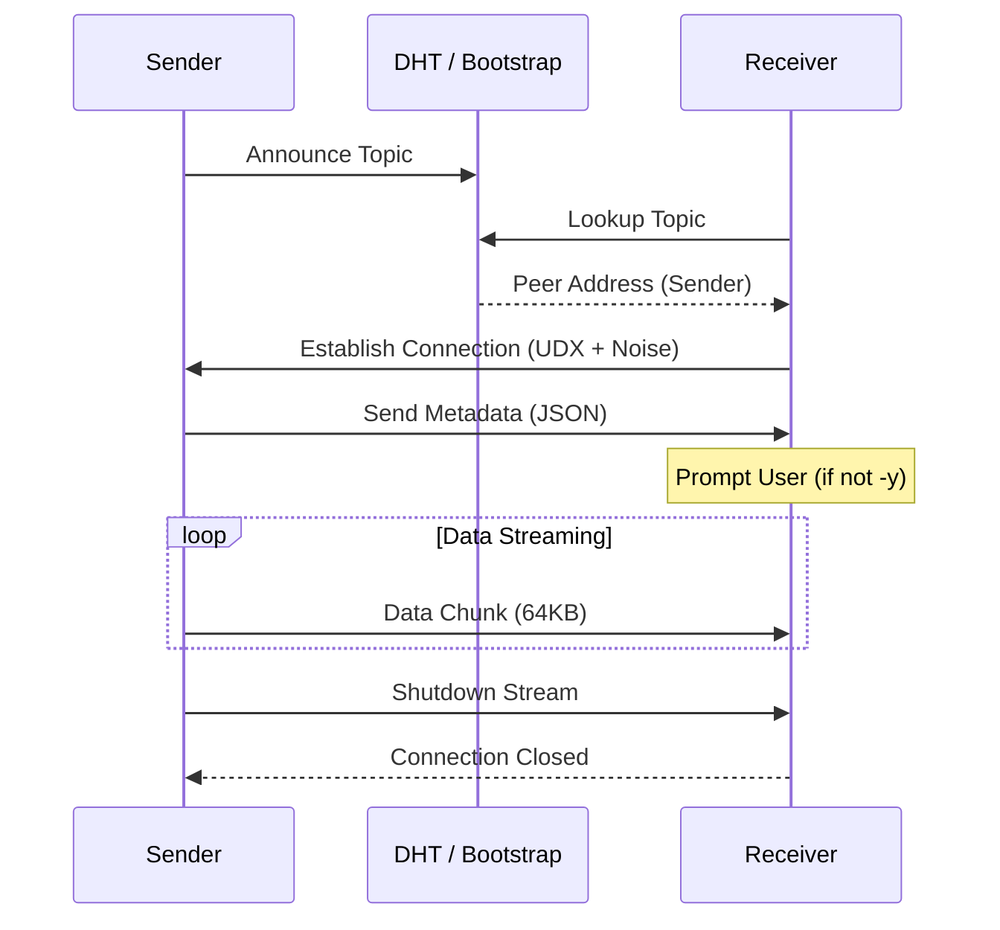

# Architecture

The `cp` tool is built on top of the `peeroxide` swarm, leveraging the DHT for peer discovery and UDX for efficient data transport.

## Data Flow

The transfer process involves two main stages: discovery and streaming.

### 1. Discovery

- **Sender**: Joins the topic on the DHT as a server (`JoinOpts { client: false, .. }`). It announces its presence and waits for incoming connections.
- **Receiver**: Joins the topic on the DHT as a client (`JoinOpts { server: false, .. }`). It looks for peers announcing the topic and attempts to connect to them.

### 2. Protocol Handshake

Once a connection is established, the peers perform a simple JSON-based handshake:

1. **Metadata**: The sender transmits a JSON object containing file information:
   - `filename`: The name of the file being sent.
   - `size`: The total size in bytes (if known).
   - `version`: The protocol version (currently `1`).
2. **Acceptance**: The receiver validates the metadata and (unless `--yes` is used) prompts the user for confirmation.

### 3. Streaming

Data is streamed in chunks (default `CHUNK_SIZE = 65536`) over the established SecretStream.

## Implementation Details

### Chunking
While the underlying UDX protocol handles packetization, `cp` reads and writes data in 64KB blocks. This balances memory usage with throughput efficiency.

### Flow Control
Each `cp` connection holds at most 8 MiB that its reader has not taken yet. When the receiver's disk is slower than the network, the stream tells the sender how much room it has left, and the sender waits for room. A peer that ignores this has what does not fit turned away, so it cannot make `cp` buffer more than that. A Node.js sender gives up if the receiver stops reading for about thirteen seconds while the buffer is full.

### File Handling
- **Temporary Files**: During a receive operation, data is written to a hidden temporary file in the destination directory.
- **Atomic Rename**: Once the transfer is complete and the received size matches the expected size, the temporary file is renamed to the final destination name. This prevents leaving partial or corrupted files if a transfer is interrupted.
- **Sanitization**: Filenames provided by the sender are sanitized to prevent path traversal attacks (e.g., removing `..` or leading slashes).

### Network Configuration
The `cp` command uses the same runtime bootstrap-resolution as every other DHT-using subcommand (via `build_dht_config(cfg)` in `peeroxide-cli/src/cmd/mod.rs`).
- **Bootstrap node selection**: CLI `--bootstrap` overrides the config file's `network.bootstrap`. `--public` adds default public bootstrap nodes; an empty list auto-fills with the defaults; `--no-public` removes them. See [init/overview.md → Global CLI Flags](../init/overview.md#global-cli-flags) for the full algorithm.
- **NAT traversal**: `cp` does not flip the node into "open firewall" mode; if the node is behind a NAT it attempts hole-punching to establish the direct connection.
